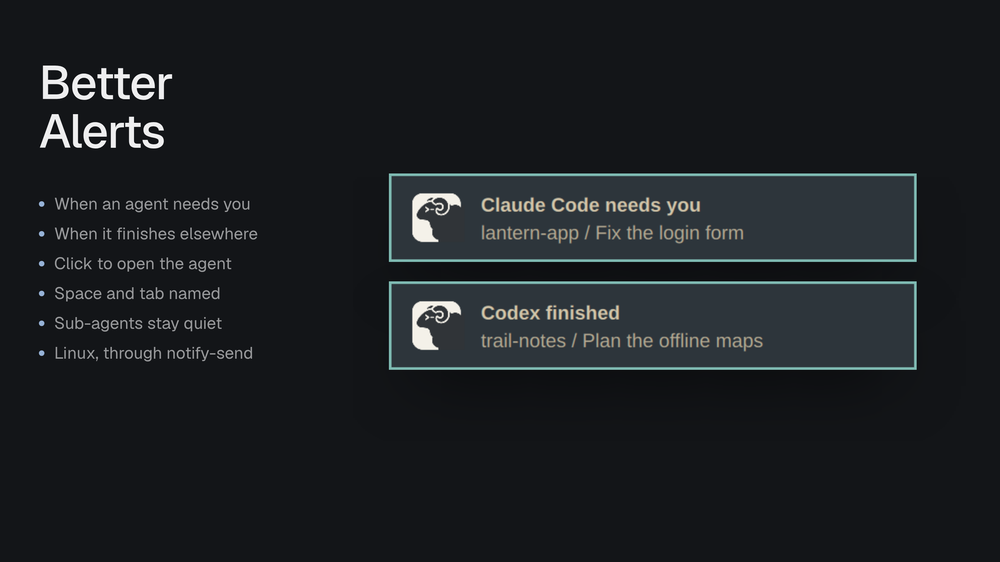

# Better Alerts

System notifications for [Herdr Desktop](https://herdr.dev/) on Linux: when an agent needs you, or finishes while you're looking elsewhere, your desktop says so, even with Herdr behind another window. Click the notification to open that agent.



- **Needs you:** an agent asks for input or permission.
- **Finished:** an agent that was working is done, and you weren't looking at it: Herdr was in the background, or another tab was shown.
- **Click** a notification's Open action and Herdr shows that agent and comes to the front.
- The title names the agent, like `Claude Code needs you`, and the body says where it is, like `lantern-app / Fix the login form`.
- Sub-agents stay quiet; their parent speaks for them. Agents already waiting when Herdr starts don't post.
- Herdr's own in-app toasts are unchanged.

## Install

Copy this prompt into your Herdr agent:

> Read ~/.config/herdr-app/AGENTS.md, then add this mod: https://github.com/munza/herdr-mods/tree/main/better-alerts

[RECIPE.md](RECIPE.md) guides the install. It draws nothing, so the agent runs it as an empty floating block in a layout you own:

```json
"floating": [{ "id": "better-alerts", "content": { "mod": "better-alerts" }, "edge": "bottom", "align": "end" }]
```

It needs `notify-send`, from libnotify, and a notification daemon such as mako, dunst or GNOME's. It runs `notify-send`, and on a click `herdr-app do agent.focus` and, on Hyprland, `hyprctl` to bring Herdr forward. It reaches no network and reads only its own folder. On macOS and Windows it does nothing.

## Settings

[Better Config](../better-config/README.md) shows these with what each one does, and changes, checks and resets them for you. By hand, add a `settings` block to the installed `mods/better-alerts/mod.json` with only what you change. The defaults:

```json
"settings": { "alerts": { "blocked": true, "done": true } }
```

`alerts.blocked: false` stops the needs-you notifications, and `alerts.done: false` the finished ones.

## Limits

- Linux only. A macOS version would need a tool such as `terminal-notifier` for the click to open the agent.
- Only Hyprland gets the window brought forward on a click; elsewhere Herdr shows the agent but may stay behind other windows.
- It checks twice a second, so a notification can come up to half a second after the change.

## Development

```sh
node --test tests/*.test.cjs
./sync.sh    # copies mods/better-alerts/ into Herdr
herdr-app check "$HOME/.config/herdr-app/mods/better-alerts"
```
