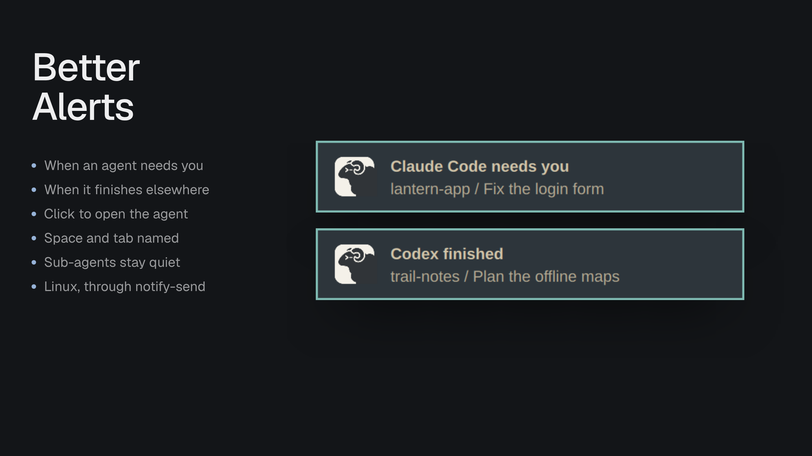

# Better Alerts

System notifications on Linux for a person directing agents in Herdr: an agent that needs them, or finishes while they're looking elsewhere, posts one, and clicking it opens that agent. Judge any addition by whether it gets the person back to an agent that's waiting, without noise.

## What you see

Nothing in Herdr's window. The mod renders an empty `div`, so its floating block takes no room. On the desktop, a notification from the app `Herdr` with the `herdr-app` icon: the title is the agent's name and what happened, `Claude Code needs you` or `Claude Code finished`; the body is `<space> / <tab>`. It has one action, `default` labelled Open, which most daemons run on a click.

## How it behaves

Every 500ms, from `cx.timer.every`, never from render, it compares each agent's status in `agents()` with the last look, kept by address:

- To `blocked`: post `needs you`.
- To `done`: post `finished` only if it was `working` or `blocked` before, and the person isn't looking: Herdr's `window().active` is false, or `focused().tab` isn't the agent's tab.
- No change, any other status, a sub-agent (a terminal in `terminals()` with a `parent`), or a kind turned off in the settings: nothing.
- Agents present when the mod starts count as seen. A new agent posts on its first status if that's `blocked`. An agent that leaves is forgotten.

The name is `program.name`, else `app`, `title` or the address.

Posting runs `sh -c 'setsid -f sh -c "$1" sh "$2" "$3" "$4" >/dev/null 2>&1 </dev/null'` with a script, the title, the body and `{"terminal":"<address>"}`, so `exec` answers at once and a click still works after its 30-second limit. The script runs `notify-send -a Herdr -i herdr-app -A default=Open -- title body`, which waits for the action; on `default` it runs `herdr-app do agent.focus <target>`, then, when `hyprctl` exists, `hyprctl dispatch 'hl.dsp.focus({ window = "class:^(herdr-app)$" })'`, which Hyprland 0.56's Lua config takes, or else `hyprctl dispatch focuswindow 'class:^(herdr-app)$'` for older Hyprland. A failed `exec` is logged once.

On any platform but `linux` (`window().platform`), it starts no timer and does nothing.

## Built from

`mods/better-alerts/`: `main.js`, `settings.js` (shared between this repo's mods), `mod.json` (`place: none`, title Better Alerts), `mod.schema.json` (its settings with their defaults, which the code's `DEFAULT_SETTINGS` must match: `alerts.blocked` and `alerts.done`, both true). It uses `agents`, `terminals`, `focused`, `window` and `exec` from `herdr`, and `div` from gpui-kit. Install it as a root `floating` block, `{ "id": "better-alerts", "content": { "mod": "better-alerts" }, "edge": "bottom", "align": "end" }`, in a layout the person owns.

## Watch out

A program run from render, or a check that runs only when render does, misses changes while Herdr draws nothing; the timer keeps it steady. `notify-send -A` blocks until the notification closes, which is why the shell is detached with `setsid -f`. Hyprland 0.56 with a Lua config rejects the classic `focuswindow` dispatcher (exit 7), and older Hyprland has no Lua one, so the script tries both. Shipped layouts are read-only, so the block goes in a layout the person owns.

## Done when

- `node --test tests/*.test.cjs` and `herdr-app check` pass.
- An agent that asks for permission posts `… needs you` with its space and tab, once.
- An agent finishing in a tab you aren't on, or with Herdr behind another window, posts `… finished`; finishing in the tab you're looking at posts nothing.
- Clicking Open shows that agent, and on Hyprland brings Herdr forward.
