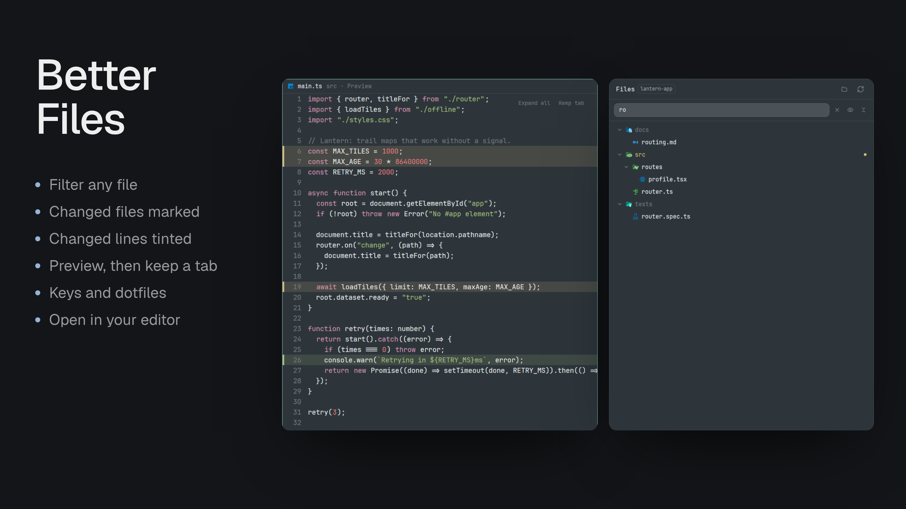

# Better Files

A file browser for [Herdr Desktop](https://herdr.dev/) that opens files in the centre pane, beside your agents, instead of squeezing them into the sidebar. Built to look like Herdr's own panels and to fit how you work with agents: see where an agent has been, read what it wrote, and hand a file to one.



- **Tree:** the focused pane's folder, named in the panel's title, with changed files coloured and lettered by what happened (green new, yellow edited, red gone or in conflict), and folders holding changes in yellow with a dot. It refreshes as files change.
- **Filter:** type in the box under the title to find files and folders anywhere in the folder, including ones you haven't opened. A name holding the words matches, and words with a `/` match the path. Matches show as a tree under their folders. Click a file to open it, or a folder to open it in the tree. **Enter** opens the first matching file, and **Escape** or **×** clears the box. In a Git repository, files Git ignores are left out.
- **Tools** beside the filter: the eye shows or hides dotfiles, in the tree and in the matches, and this computer remembers it. **Collapse all** closes every folder.
- **Keys:** click the tree, or press a key you bind to `better-files.focus` in `keys.json`, and the tree takes the keyboard, with a marker on a row. **Up**/**Down** or **j**/**k** move, **PgUp**/**PgDn** move 10, and **Home**/**End** go to the ends. **Right** or **l** opens a folder, then steps into it; **Left** or **h** closes it, then steps out. **Enter** opens the row, **/** goes to the filter, **.** shows or hides dotfiles, and **Escape** clears the marker. In the filter box, **Up**/**Down** move through the matches and **Enter** opens the marked one.
- **Click** a file to show it in one shared centre tab, so browsing doesn't pile up tabs.
- **Double-click**, or **Keep tab**, to keep that tab. The next click starts a new shared tab.
- **The file view** is read-only, at your terminal's font size, and follows the file as it changes on disk. Only a real change touches it. Binary and unreadable files say so, and very long files are cut at 400,000 characters.
- **Changed lines:** lines that differ from the last commit are tinted, with a solid bar at their edge: green added, yellow changed, and a thin red line across the file where lines were removed. A new file is all green. Click a yellow line or the red line to open the change in place, with the old lines in red, and click again to close it. **Expand all**, beside Open in, opens or closes them all at once. They update as the file changes, and clear when it's committed. The file is drawn as rows so the colours can't drift, so text can't be selected and there's no folding, and highlighting is simpler. Use **Open in** for those, or turn `gutter` off.
- **Images:** PNG, JPEG, GIF, WebP, BMP and SVG files show as pictures, fitted to the pane, and update when the file changes. Herdr only loads images from its own folder, so each is shown through a copy in `mods/better-files/cache/`, removed when its tab closes.
- **Markdown:** a `.md` or `.markdown` file opens rendered, in Herdr's own Markdown view: headings, lists, tables, code blocks, quotes, links and the rest, with text you can select. **Preview** and **Code**, beside Open in, switch between that and the file view with its changed lines; each tab remembers its choice, and `markdown` in settings picks the first one. A web link opens in your browser, and a link to another file here opens it in the viewer. A picture on a line of its own, from this computer, shows through the cache like an image file; one inside a paragraph, list or table, or from the web, is left to Herdr's view. The preview follows the file as it changes on disk.
- **Open the whole folder** in your editor or Finder, from the folder icon beside refresh.
- **One title:** the tab's title row reads like a diff's, with the file, its folder, and Preview while it's the shared tab.
- **Open in** your code editor, from the tab or the menu. Zed, VS Code, Cursor, Windsurf, Sublime Text and Nova are offered when installed, and you can add more.

## Right-click

| Item | What it does |
| --- | --- |
| **Open**, **Open in new tab** | In the shared tab, or a tab of its own. Files only. |
| **Open in** an editor | Each installed editor. Folders too. |
| **Open in default app** | Whatever macOS opens that file with. |
| **Show in Finder** | Reveals it. |
| **Show diff** | Opens a changed file's diff in [Better Changes](../better-changes/README.md), if you have it. |
| **Copy relative path**, **Copy full path** | For pasting into a prompt. |
| **Send to** an agent | Asks what it should do, then sends that with the path. Choose an agent that's running, **(spawn)** to start a sub-agent under it, or a new one in its own tab. Only **Send** delivers. |

The path goes to the agent and not the file's text, so it reads the file as it is by then.

A space on another machine has no editor, default app or Finder items, because those apps are on this computer.

Editing, and creating, renaming or deleting files, aren't here on purpose: that's what your editor is for, and a file browser with a delete item is a way to lose work.

## Install

Copy this prompt into your Herdr agent:

> Read ~/.config/herdr-app/AGENTS.md, then add this mod: https://github.com/munza/herdr-mods/tree/main/better-files

[RECIPE.md](RECIPE.md) guides the install. Herdr's shipped layouts are read-only, so the mod only shows in a layout you own. Requirements: `sh`, and Git for the marks. Finding editors uses macOS Spotlight.

## Place the sidebar

The manifest has `place: none`, so add it to a layout you own, or point a block that uses Herdr's `files` at it:

```json
{ "id": "files", "type": "block", "content": { "mod": "better-files" } }
```

## Settings

[Better Config](../better-config/README.md) shows these with what each one does, and changes, checks and resets them for you. By hand:

Add a `settings` block to the installed `mods/better-files/mod.json` with only what you change. Saving it applies at once. `mod.schema.json` beside it describes every setting, so an editor that reads `$schema`, such as VS Code or Zed, checks the block as you type. The defaults:

```json
"settings": {
  "refresh": { "tree": "10s", "file": "2s" },
  "editors": [{ "name": "PhpStorm", "bundle": "com.jetbrains.PhpStorm" }],
  "gutter": true,
  "markdown": "preview"
}
```

`refresh.tree` is how often the tree rereads, on top of watching the folder, and never closer than 1 second. `refresh.file` is how often an open file is checked, never closer than 500ms. `editors` adds to the built-in list, by macOS app ID, and is only offered if installed. `gutter: false` uses Herdr's own editor instead: fuller highlighting, selection and folding, but no line colours. `markdown` is how a Markdown file first opens, `"preview"` or `"code"`; the toggle in a tab overrides it for that tab.

## Limits

A folder lists its first 500 entries, and the tree shows 5,000 rows. The filter shows 200 matches and searches up to 40,000 files; outside a Git repository it goes 12 folders deep (5 in a home folder or `/`) and skips `.git`, `node_modules`, `.venv`, `__pycache__`, `target`, `dist` and `.next`. A file view can't report a selection or jump to a line, because Herdr's editor component offers neither, so you send whole files and an editor opens at the top. Listing a folder needs `sh`, so a Windows machine shows an error.

## Development

```sh
node --test tests/*.test.cjs
./sync.sh
herdr-app check "$HOME/.config/herdr-app/mods/better-files"
```

`mods/better-files/main.js` lists what's where. Tests use stand-ins for Herdr, so also look at the running app.

See [LICENSE](../LICENSE) and [NOTICE](../NOTICE) for attribution.
