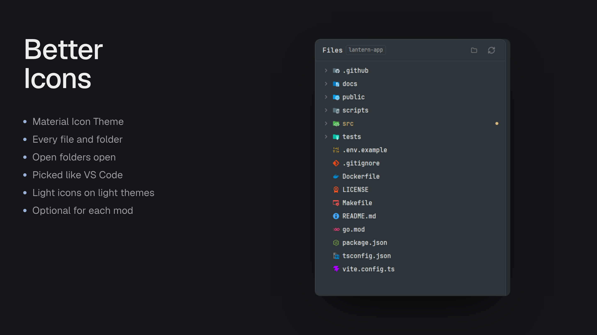

# Better Icons

The icons of VS Code's [Material Icon Theme](https://github.com/material-extensions/vscode-material-icon-theme) for [Herdr Desktop](https://herdr.dev/) mods. Install it beside [Better Files](../better-files/README.md) and every file and folder gets a colour icon: a TypeScript file, a `package.json`, a `.github` folder and a `src` folder each look different, and an open folder shows its open icon.



- **Nothing to place.** It isn't a panel: other mods read its icons by path. Shown in a layout anyway, it lists a few names with their icons.
- **Optional.** A mod that uses it keeps its own plain icons when it isn't installed.
- **Picked the way VS Code picks them:** a rule for a path, such as `.github/workflows`, beats a name, a name beats an extension, and the longest extension wins, so `app.spec.ts` gets the test icon and `app.ts` the TypeScript one. Light themes get the light icons where the theme has them.
- 1,184 icons from Material Icon Theme 5.40.0, about 5 MB.

Mods that use it: [Better Files](../better-files/README.md).

## Install

Copy this prompt into your Herdr agent:

> Read ~/.config/herdr-app/AGENTS.md, then add this mod: https://github.com/munza/herdr-mods/tree/main/better-icons

[RECIPE.md](RECIPE.md) guides the install. It runs no programs, reaches no network, and reads only its own folder. There are no settings.

## Limits

- About 5 MB of icons. Only Better Files uses them so far.
- A mod reads the table when it starts, so after an update reopen its panel or restart Herdr.
- A symlinked mod folder loads code but not icons, so install by copying, as `sync.sh` does.

## Update

Copy `mods/better-icons/` again. Mods that use it read the table when they start, so reopen their panels or restart Herdr.

## Development

```sh
node --test tests/*.test.cjs
./sync.sh    # copies mods/better-icons/ into Herdr
```

To move to another Material Icon Theme release, change `VERSION` in `generate.mjs`, then:

```sh
npm pack material-icon-theme@<version> && tar xzf material-icon-theme-<version>.tgz
node generate.mjs package
```

It reads the package's `dist/material-icons.json` and copies only the icons that table names. It runs none of the package's code. The tests then check every named icon is there.

A mod that shows these icons keeps a copy of `mods/better-icons/file-icons.js`, because a mod can't import from another's folder. A test checks every copy in this repo matches.

## Licence

The icons are MIT-licensed, copyright (c) 2025 Material Extensions. The licence ships beside them as `LICENSE-material-icon-theme.txt`.
