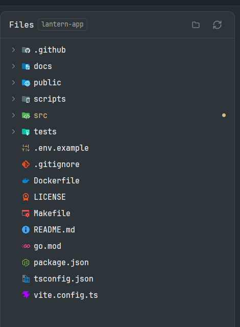

# Better Icons

An icon pack for this repo's mods: the icons of VS Code's Material Icon Theme, and a table that says which icon each file name, extension and folder name gets. It draws nothing in a person's layout. Judge any addition by whether it makes a file easier to recognise at a glance in a mod that lists files.



## What you see

Nothing of its own. In Better Files, each tree row and the file tab's title row show a full-colour 14px icon in place of the plain file or folder: `package.json` the Node icon, `Dockerfile` the Docker whale, `src` a green folder with `</>`, `.github` a folder with the GitHub mark. An open folder shows its open icon. Under a light theme, the 236 names the theme has light icons for (179 file names, 32 extensions, 25 folder names) use them.

If a layout shows `{ "mod": "better-icons" }` anyway, it lists seven sample names (`src`, `.github/workflows`, `package.json`, `main.ts`, `main.spec.ts`, `README.md`, `Dockerfile`) in 26px rows with 16px icons, under a 12px `dim` line naming the source, on `background`.

## How it works

`mods/better-icons/icons.json` is one object:

```
{ source: "material-icon-theme 5.40.0", file: "file", folder: "folder",
  fileNames: {…2156}, fileExtensions: {…1391}, folderNames: {…4674},
  open: { <folder icon>: <its open icon>, …274 },
  light: { fileNames, fileExtensions, folderNames } }
```

Keys are lower case; values name an SVG in `mods/better-icons/icons/` without `.svg`. Every folder icon has an entry in `open`, so the 4,674 open folder names aren't stored twice.

`file-icons.js` exports `loadFileIcons()`, which reads `${appHome()}/mods/better-icons/icons.json` and returns the table, or null when it's missing, unreadable or not a table, and `fileIcon(table, relative, { dir, open, light })`, which returns `mods/better-icons/icons/<name>.svg`, or null with no table. `relative` is the path from the folder on show. It lowers the path and tries, in order: each ending of the path with two or more parts, longest first (`app/.github/workflows`, then `.github/workflows`); the name; for a file, each extension from the longest (`spec.ts`, then `ts`); then the plain file or folder. With `light`, each lookup tries the light table first. With `open`, a folder icon becomes its open one.

A mod that uses the pack keeps an identical copy of `file-icons.js`, calls `loadFileIcons()` once per copy in `init`, and draws the result with `image()`, not `svg()`, which would tint it one colour. With null it draws its own icon. `settings().dark === false` means light.

`generate.mjs` builds the folder from the unpacked `material-icon-theme` npm package at the version it names, refusing any other: it reads `dist/material-icons.json` (whose extension table already folds in VS Code's language ids), maps each icon id to its SVG's file name (36 differ), lowers the keys and fails on a clash, pairs each folder icon with its open one and fails if one has two, then copies the 1,184 SVGs the tables name and the package's `LICENSE` as `LICENSE-material-icon-theme.txt`. It runs none of the package's code.

## Built from

`mods/better-icons/`: `main.js` (the sample list), `file-icons.js`, `icons.json`, `icons/` (1,184 SVGs), `LICENSE-material-icon-theme.txt`, `mod.json` (`place: none`, title Better Icons, no settings), `mod.schema.json`. Beside it: `generate.mjs`, `tests/icons.test.cjs`, `sync.sh`. It imports `View`, `div`, `image`, `h_flex`, `v_flex`, and from Herdr `appHome`, `readTextFile`, `settings`, `theme`. It runs no programs and makes no network calls.

## Watch out

The folder name is fixed: users read `mods/better-icons/icons/<name>.svg` by path. If a mod named `better-icons` is already installed and isn't this one, stop and ask rather than rename, since every user would need the new path.

Don't hand-edit `icons.json` or `icons/`; regenerate them. Keep `LICENSE-material-icon-theme.txt` with the icons.

A user's copy of `file-icons.js` must match this one byte for byte; the test walks the repo for copies.

## Done when

- `node --test tests/*.test.cjs` passes, and `herdr-app check` passes for `mods/better-icons`.
- Every icon the table names is in `icons/`, and nothing else is: 1,184 files.
- `package.json`, `Dockerfile`, `main.ts`, `main.spec.ts`, `notes.draft.md`, `src` (shut and open) and `.github/workflows` get `nodejs`, `docker`, `typescript`, `test-ts`, `markdown`, `folder-src`/`folder-src-open` and `folder-gh-workflows`; an unknown name gets `file` or `folder`.
- With it installed, Better Files' tree shows these icons; without it, Better Files shows its plain ones.
