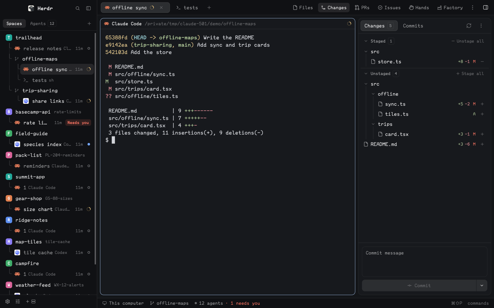

# Estro

*Estro* is Esperanto for the one in charge. A layout for directing agents: every space and agent on the left, the session you're with in the middle, and on the right everything you need to check their work and hand them more.

This file is the brief: enough to build Estro from an empty folder. The files next to it are one build of it.

## What you see

A row filling the window, with no title bar, `canvas` behind and 1px `border` dividers. Terminals have 14px and 12px padding.

**Sidebar, 268px.** Herdr's `workspace-chrome` brand block at 46px. Below, Better Sidebar's spaces and agents in one block (`view: lists`), under Spaces and Agents tabs, each space's tabs and agents beneath it on Spaces: branches beside space names, a pull request's state at the right of the row, and worktrees nested under their repository. Better Sidebar's one-line footer closes it at 37px, with Settings, Mod settings (Better Config's dialog) and Add machine.

**Work area, the rest.** At the top, 42px, Better Tabs with Better Sidebar's 36px panel toggle at the far right. In the middle, the active tab's terminals, with a 368px panel on the right. At the bottom, Herdr's 28px `workspace-status`.

**The panel** is a stack of one view at a time, chosen from the toolbar in Better Tabs:

| Button | Mod | For |
| --- | --- | --- |
| Files | Better Files | Browsing, reading files in the centre, and handing them to an agent |
| Changes | Better Changes | What changed, staging, commits and diffs |
| PRs | Branch PR | What's in the way of a merge, and handing it to an agent |
| Issues | Branch Issue | Linear issues, and starting work on one |

Better Config has no block: it's a dialog of every mod's settings, opened from the footer's Mod settings button.

The toolbar's buttons are `panel` actions with `container: "panel"` and `stack: "panel-body"`, and each space remembers its panel through `rememberPanels`.

## Installing it

**`mods/` here holds pointers, not mods: don't copy it.** Each `mods/<mod>/RECIPE.md` names the mod's real home in [munza/herdr-mods](https://github.com/munza/herdr-mods). Two of them need a helper built from source, which copying could never do, and this keeps one copy of each mod.

Copy only `layouts/estro.json`. Then add each mod with its pointer's prompt, for example:

> Read ~/.config/herdr-app/AGENTS.md, then add this mod: https://github.com/munza/herdr-mods/tree/main/better-changes

Do that for `better-files`, `better-changes`, `better-sidebar`, `better-tabs`, `better-config`, `branch-pr` and `branch-issue`, reading each mod's README and telling the person what it can do first. Skip any step in a mod's recipe that places it in a layout, because Estro already does. Where a mod is already installed, update it instead.

Anyone who doesn't want one of them can drop its button and block from the layout: Branch PR needs `gh` and Branch Issue a Linear key. Both need Go 1.23+ to build their helper.

Then `herdr-app check` each mod and `layout.switch {"name": "estro"}`.

## Built from

`layouts/estro.json`, with `cloned_from` Herdr's `main`, and `mods/`, a one-line pointer for each of `better-files`, `better-sidebar`, `better-tabs`, `better-changes`, `better-config`, `branch-pr` and `branch-issue`. `workspace-chrome` and `workspace-status` ship with Herdr. Each mod's own `RECIPE.md` in [munza/herdr-mods](https://github.com/munza/herdr-mods) is the brief for that mod.

## Watch out

Never overwrite a mod or layout already there under the same name. The panel is 368px because the mods are drawn for that width.

## Done when

- `herdr-app check` passes for each mod, and the layout shows with all four panel buttons.
- Each button opens its panel, and a mod with a helper shows real data or says what's missing.
